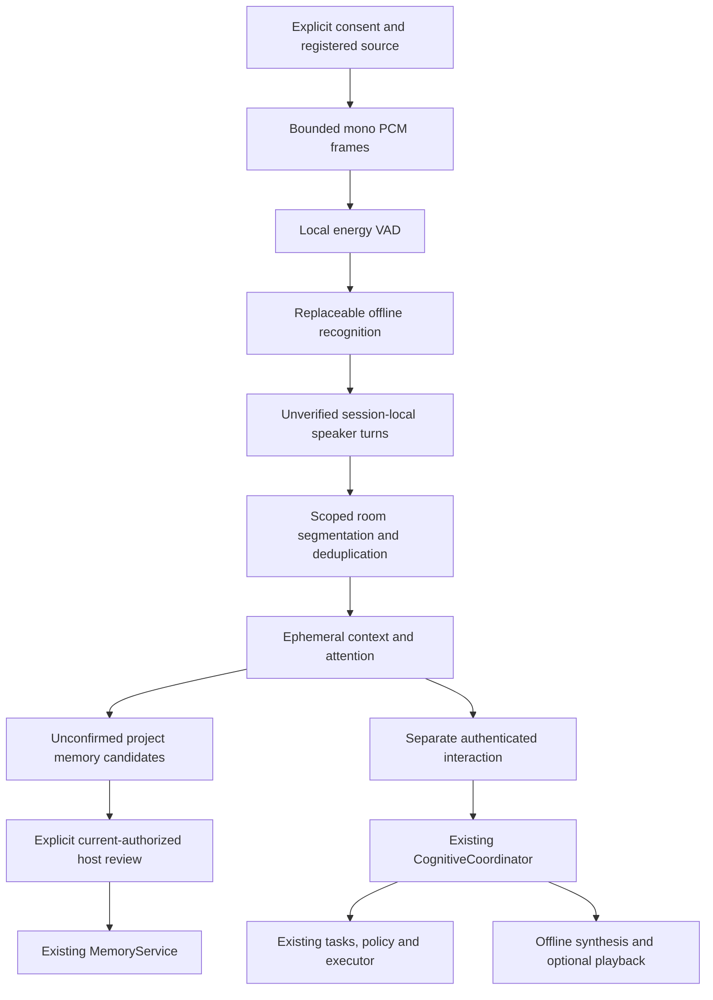

# Phase 10: local voice and ambient audio development

This milestone adds an explicitly activated local push-to-talk client and bounded
ambient audio simulation to the Phase 9 application. Deterministic fixtures are
not AI reasoning, biometric recognition or proof of real acoustic performance.
The initial cloud run used executable protocol fixtures because model downloads
were blocked. Follow-on validation built whisper.cpp v1.8.2, verified tiny.en and
base.en weights, and exercised genuine Linux STT/TTS plus authenticated audio-file
integration. Gemma, physical microphone/playback and macOS speech remain unverified.
See the [operator acceptance checklist](VOICE_ACCEPTANCE.md) and measurements below.

## Architecture and authority



`Application.audio` shares existing identities, permissions, conversation service,
memory, models, tasks, notifications and audits. No additional executor exists.
The live `voice` client sends authenticated text to the existing conversation HTTP
API. Host metadata controls reuse existing repositories; they never instantiate a
second cognitive runtime. Audio models/devices are not opened during core startup.
Maintenance expires ephemeral buffers, contexts and candidates independently of
worker credentials; shutdown clears them. Capture and speech processing run in the
explicit client or a caller-owned asynchronous host pipeline, outside the task and
notification scheduler. The host pipeline admits one processing request at a time
and rejects excess work with backpressure. Future adapters must track/drain their
own submitted processing work through runtime lifecycle operations.

Source registration/activation require the pinned owner and `audio.sources.manage`.
Capture requires current `audio.process`, exact source ownership, enabled/available
source, permitted session binding and unexpired session. Continuous mode also
requires source `continuous_allowed`. Voice source IDs and diarization labels
never establish principal identity. An ambient producer credential authorizes
processing, **not** a speaker's privileged request: `VoiceService.process` requires
a separately supplied trusted interaction credential before responding. Unknown or
overlapping speakers require trusted clarification and invoke no model or handler.
Spoken/model-generated owner claims cannot set that credential.

The push-to-talk client is a development-authenticated interaction channel. Anyone
with its credential and access to its microphone could speak into that activated
session: it supplies no biometric assurance. Protect the credential/device and
mute capture when visitors or call participants have not consented.

Audio-derived cognition refuses cloud provider routing in this phase, even if
future general model egress is authorized. STT/TTS invoke explicit offline binaries
without shell execution, proxy requests or cloud fallback. Current capability grants
still govern every actual action; audio registration grants none. Revocation/mute
are rechecked after STT and before playback. Accepted actions may already be running
when a source is muted; muting does not undo an effect. The spoken text is the
coordinator's verified response, including pending, denied and ambiguous outcomes.
Unsolicited audible participation is disabled. The `quiet` policy suppresses delivery;
there is no automatically configured schedule or spoken notification channel.
Existing notifications/initiatives remain accessible through authorized cognition,
with existing quiet/rate/approval policy. Deferred automatic ambient suggestions
remain disabled.

## Contracts, buffers, retention and recovery

`core/audio_records.py` supplies strict v1 `AudioFrame`, `AudioSource`,
`SpeechSegment`, `TranscriptionResult`, `SpeakerTurn`, `ConversationSegment`,
`AmbientConversation`, `AttentionDecision`, `VoiceSession`, `SpokenResponse` and
`MemoryCandidate`. `decode_contract` delegates audio decoding and checks explicit
nested versions. Extra identity/authority fields are rejected.

Frames are mono 16 kHz signed little-endian PCM16, 10–100 ms and at most 3,200 bytes.
The frontend checks source/session/correlation, monotonically increasing sequence
and time, resets speech across dropped frames, reports dropped counts, keeps two
lookback frames and splits at at most 100 frames/10 seconds. Source disconnect
clears raw buffers; reconnect explicitly resets stream sequence. Ingestion admits
at most 16 streams. Expired idle buffers are erased during maintenance; no raw audio
is stored in SQL, audit, metrics or logs. Temporary recognizer/synthesizer files are
in a private temporary directory and removed after completion/cancellation. STT JSON
is bounded to 64 KiB; synthesized mono WAV is bounded to 60 seconds/6 MB. Provider
subprocesses have explicit deadlines, no shell, and are killed and waited on after
cancellation/timeout.

Energy VAD is a simple configurable RMS threshold heuristic, not a trained detector.
VAD confidence and STT confidence are separate; whisper.cpp confidence stays unknown.
The live diarization fallback represents `speaker_1` with attribution confidence 0.
Fixture labels/overlap represent test evidence, never verified people. Segmentation
uses voice session plus room, bounded to 16 contexts and 16 turns per context.
Explicit host handoff can preserve a session across rooms; real acoustic localization,
semantic grouping and diarization are deferred. Two distinct microphones producing
identical normalized transcripts within two seconds in the same session/room are
suppressed using a bounded hash cache. This is a simulation-compatible heuristic;
real noisy cross-microphone transcription may differ, and coincidental identical
utterances may be suppressed. Different rooms and sessions remain separate.

Attention distinguishes direct addressing, recent authenticated follow-up, indirect
addressing, environmental/project information and background conversation. Follow-up
expires after 30 seconds. Background speech does not enter cognition or permanent
memory. Context expires after source-configured 1–300 seconds (default 60), bounded
by session expiry (at most 300 seconds). Explicit context deletion clears transcripts,
buffers, deduplication and candidates. `current_context` checks current ownership,
source activation and capture permission before returning transcripts.

Narrow deterministic extraction recognizes only Slipstream project statements;
questions, hypotheses and corrections remain distinct. Candidates preserve exact
supported text, turn/speech references, STT provenance/uncertainty, scope, expiry and
required authority. Up to 32 are held ephemerally. No profiling or automatic durable
write occurs. `confirm_candidate` requires current `audio.memory.confirm` **and**
existing `memory.write`, explicit consent and current source eligibility. It writes
an expiring private `audio_candidate` marked `unverified_candidate` through
MemoryService; it does not supersede semantic truth. Repeated confirmation within
that candidate's lifetime returns the current authorized record. Third-party consent
and the truth of a candidate cannot be verified by the extraction heuristic.

Explicit schema migration 9 adds only source policy and voice-session metadata.
Existing credentials, grants/revocations, tasks, events and memories are preserved;
no source enrollment or grants occur during migration. Before serving an existing
schema-8 development store, stop its server, take an online backup, run
`jarvis db-init --database <existing-runtime-database>` and restart normally.
Schema and API wire versions are distinct; HTTP v1 and default port 8765 remain.

After restart, policy and authorized conversation/task state persist; raw audio,
speaker labels, attention participation and unconfirmed candidates deliberately do
not. No device is reopened or unknown action retried because it was heard earlier.
Existing completed-request replay and ambiguous-task recovery remain authoritative.
Explicitly submitted push-to-talk requests are normal permitted durable conversation
turns, not a retained full ambient transcript. Their retention follows the existing
conversation subsystem; automatic physical purge remains OPEN. Source transcript TTL
controls ephemeral ambient awareness, not a promise to delete prior API messages.

## Installation and explicit configuration

Install the optional device adapter only on the client machine:

```sh
uv sync --locked --extra voice
```

macOS prerequisites (Homebrew is an operator choice, not a core requirement):

```sh
brew install portaudio cmake
```

Linux prerequisites (Debian/Ubuntu):

```sh
sudo apt-get install libportaudio2 portaudio19-dev espeak-ng cmake build-essential
```

macOS TTS uses an installed offline system voice. Inspect with `say -v '?'` and
select an already installed voice (`--tts-voice Samantha` by default). Linux uses
`espeak-ng` and defaults to `en-us`. No download of additional system voices is
triggered by JARVIS. Rate is bounded 80–350 words/minute (default 175). Output-device
selection uses PortAudio indices. TTS provider protocol tests are not a hardware
playback test.

Build whisper.cpp outside this repository and explicitly download the tiny English
model. Never commit weights. The reproducible script checks the source commit and
model SHA-256 before use; it was run twice against the verified installation.

```sh
uv run --no-sync bash scripts/install_whisper.sh "$HOME/jarvis-audio/whisper.cpp"
```

Expected SHA-256 for the published tiny.en artifact reviewed here:
`921e4cf8686fdd993dcd081a5da5b6c365bfde1162e72b08d75ac75289920b1f`.
Compare before use. TLS and checksum verification must remain enabled; a changed
artifact requires review, not a bypass. Language/model selection is explicit;
backend inference is local. CLI expects mono 16 kHz PCM16 and uses two CPU threads.

Start your Phase 9 runtime normally with a reachable configured local model. Fake
cognition is an explicit development option and does not provide real reasoning.
Read the pinned owner principal ID from the existing trusted host repository;
print only that ID, never dump the credential file. Then grant only the exact
permissions needed through existing owner administration:

```sh
uv run python -c 'from pathlib import Path; from jarvis.runtime_config import RuntimeSettings; from jarvis.storage.sqlite import SQLiteDatabase; from jarvis.local_credentials import LocalDevelopmentIdentityRepository; settings=RuntimeSettings.load(Path(".jarvis/dev/runtime.json")); print(LocalDevelopmentIdentityRepository(SQLiteDatabase(settings.resolved_runtime_database_path)).owner_id)'
```

```sh
uv run jarvis permissions grant --config .jarvis/dev/runtime.json --credential-file .jarvis/dev/credentials/owner.json --principal OWNER_UUID --permission audio.sources.manage
uv run jarvis permissions grant --config .jarvis/dev/runtime.json --credential-file .jarvis/dev/credentials/owner.json --principal OWNER_UUID --permission audio.process
uv run jarvis audio register --config .jarvis/dev/runtime.json --credential-file .jarvis/dev/credentials/owner.json --source local.microphone --location computer --consent-ref consent:explicit-local-user
uv run jarvis audio devices
uv run jarvis audio mic-test --device "$JARVIS_INPUT_DEVICE" --seconds 5 --consent-ref consent:explicit-local-user
uv run jarvis audio tts-test --text 'Local speech test' --tts-rate 175
```

`audio register` creates/updates source policy explicitly and enables that source;
it still opens no microphone. Omit `--continuous` and `--memory-candidates` for
push-to-talk. Future phones/wearables are metadata categories only, unavailable
for actual processing. `audio mute` immediately disables a configured source.
Participant awareness/consent is an operator responsibility; proximity is no proof.

## Push-to-talk and manual acceptance

```sh
uv run jarvis voice --config .jarvis/dev/runtime.json --credential-file .jarvis/dev/credentials/owner.json --source local.microphone --device "$JARVIS_INPUT_DEVICE" --output-device "$JARVIS_OUTPUT_DEVICE" --seconds 10 --stt-binary ~/jarvis-audio/whisper.cpp/build/bin/whisper-cli --stt-model ~/jarvis-audio/whisper.cpp/models/ggml-tiny.en.bin
```

Enter begins visible capture, Enter again releases it; capture always closes after
at most `--seconds` (maximum 10). Choose actual indices with `audio devices`
and define the variables as shown in [the checklist](VOICE_ACCEPTANCE.md).
Do not assume device 0/1. Input levels are visible. Speak "JARVIS, what do
you remember about Slipstream?". Verify the transcript, authorized memory reply,
local synthesized playback, model provenance and actual task state. Repeat with
"Set lights to 25" using simulated lighting only, and test guest denial. Enter during
playback cancels it; `/exit`, EOF or Ctrl-C releases owned devices. Continue or use
`--conversation UUID` to resume your owned persisted conversation. Transcripts can
appear on the operator's terminal; do not capture sensitive sessions in shared logs.

Standalone STT accepts a <=10-second mono 16 kHz WAV:

```sh
uv run jarvis audio stt-test --wav /private/path/sample.wav --stt-binary ~/jarvis-audio/whisper.cpp/build/bin/whisper-cli --stt-model ~/jarvis-audio/whisper.cpp/models/ggml-tiny.en.bin
uv run jarvis audio sessions --config .jarvis/dev/runtime.json --credential-file .jarvis/dev/credentials/owner.json
uv run jarvis audio mute --config .jarvis/dev/runtime.json --credential-file .jarvis/dev/credentials/owner.json --source local.microphone
```

`voice --fake --text 'What does Slipstream use?'` explicitly simulates STT/TTS/device
IO while still using your authenticated live API; it does not override the server's
model configuration or create credentials. Failed model/STT/TTS/API/device operations
report stable codes. There is no silent cloud or fake fallback. Standalone diagnostic
commands (`mic-test`, `stt-test`, `tts-test`) are trusted local operator tools, never
remote capability handlers. Do not use them to record unconsenting people.

## Offline demonstrations and measurements

```sh
uv run jarvis voice-demo
uv run jarvis ambient-demo
```

Both execute PCM ingestion/VAD, fake STT/TTS, current-authorized cognition/tasks,
private persistent services, guest denial and a separate-process metadata/history
restart. Voice demo additionally exercises the installed voice client against a
real child HTTP runtime. Ordinary speech produces OBSERVE and no response. Direct
requests and an active follow-up produce real verified outcomes. Another microphone
is suppressed; another room remains separate. Tentative project candidates are not
confirmed; unknown speaker instructions invoke no action. Disconnect/expiry and
playback cancellation are executed, not printed as fixed successes. JSON includes
actual conversation/source/speaker/candidate/audit references, denied/successful
outcomes, suppressed duplicate counts and restart observations.

Example selected output (IDs and timings vary):

```json
{"status":"ok","mode":"offline_simulated","lighting_calls":[25],"suppressed_duplicates":1,"candidate_status":"hypothetical_unconfirmed","restart":{"durable_turns":3,"ephemeral_contexts":0,"active_microphones":0}}
```

`simulated_stage_ms` measures ingestion, VAD, STT, segmentation, attention, candidate
evaluation, cognition, synthesis, playback and total processing. Simulated CPU time
and peak Python allocation are measured using process usage/tracemalloc. These are
finite multi-source fixture measurements. Latest per-stage samples can come from
different utterances (including silent/background decisions); do not sum them as
a single response. They are not real recognition, device playback
start latency, sustained CPU benchmarks or an accepted latency SLO. Missing real
hardware measurements remain unverified. Frame and provider/context limits above
bound work; future real satellites need enrolled local authenticated transport,
participant controls and clock synchronization before use.

## Runtime integration test port fix

Baseline: **800 tests passed** before edits in 134.42 seconds (one upstream warning).
A controlled unrelated listener on 8765 returned public readiness and rejected
foreign credentials. It reproduced all **three** failures before edits: requests
were sent to that listener and `.json()["data"]` raised KeyError; the owned child
could not bind and cleanup replaced the original exception.

Tests and packaged runtime-demo now reserve an OS-selected loopback listener for
the entire child lifetime and inherit its descriptor. The child uses the same
`serve_runtime`/LocalServer lifecycle as `jarvis serve`. An owned socketpair carries
an acknowledgement **after** Uvicorn binds that listener and starts the application;
only then is public readiness checked. There is no close-and-rebind allocation race
and another server cannot supply the acknowledgement. Both restart processes use
owned sockets; database and private credentials remain per-test. The production
default is still 8765, and ordinary CLI/API contracts are unchanged.

HTTP assertions report actual HTTP status and stable error code without printing
secret bodies. Cleanup addresses only the Popen child, waits after signals, and
checks only that run's log portion. A cleanup failure adds a note to an existing
assertion instead of replacing it; standalone shutdown failures still fail. Actual
SIGKILL, SIGINT, runtime-claim release, credentials and safe/ambiguous recovery
coverage remain. Regression tests repeat those workflows with an unrelated process
on 8765. If a development server already occupies it, tests leave it untouched and
exercise isolation against that occupied port. Listener inheritance is POSIX-specific,
matching the existing local file-claim/signal platform scope.

## Files and requirements

New modules: `core/audio_records.py`, `audio_ports.py`, `audio_frontend.py`,
`speech.py`, `ambient.py`, `voice.py`, `voice_cli.py`, `voice_demo.py`,
`storage/audio.py`; enforcement tests in `tests/test_audio.py`.
Composition/runtime/CLI/documentation, packaging/lock, migration and runtime tests
are extended in place. No authorization or recovery subsystem is replaced.

Addressed: INT-001 and provisional INT-002; ARCH-001–004, COG-001, IAM-004/007,
PER-001–003, CAP-002/003, TASK-001/002, EVT-001, MEM-001–006, WORLD-001–003,
AUTO-003, COM-001 integration, SEC-001–004, REL-001/002 and DEV-001/003.
INT-002 remains PROPOSED; INT-003 remains LEGACY. ADR-T11 is provisional. Production
authentication, biometric identity, final audio schemas, actual diarization,
collection/retention policy, encrypted storage, acoustic deduplication/localization,
real notification channels, final storage/scheduler and latency SLOs remain OPEN.

Next milestone: validate real hardware/local inference and strengthen deployment
identity, participant/retention controls and enrolled local satellite transport
before enabling room-wide capture or real device actions.


## Initial implementation validation (historical)

- Before edits: 800 tests passed in 134.42s; occupied-8765 reproduction failed all
  three targeted real-process cases with the reported envelope/cleanup symptoms.
- After changes: **873 tests passed** in 165.12s on Python 3.12.14, with one upstream
  Starlette/AnyIO deprecation warning. This adds 69 audio and four runtime cases.
- All 35 runtime tests passed; the three originally failing workflows passed in
  three additional occupied-8765 runs (nine executed cases). Regression tests also
  exercise actual SIGKILL/SIGINT and crash recovery with an unrelated listener.
- Python 3.13.5: 143 affected audio/runtime/API/documentation tests passed in 53.83s
  with the same upstream warning. The full local suite was run on Python 3.12;
  hosted CI contains the full 3.12/3.13 matrix.
- Ruff lint and format checks passed (150 files), locked install including the
  optional voice extra passed, source/wheel packaging passed, and whitespace passed.
- `docs-check`: 41 Markdown documents, 104 internal links, three exact generated
  references and 25 unchanged HTTP OpenAPI paths passed.
- All eleven source demos passed. A wheel installed outside the checkout imported
  from site-packages and passed voice, ambient and runtime demos.
- In one simulated run, latest stage snapshots included ingestion 6.45ms, VAD 0.91ms,
  fake STT 0.018ms, segmentation 0.098ms, attention 0.025ms, cognition 87.62ms,
  fake TTS 0.070ms and fake playback 0.066ms. Peak traced Python allocation was
  327,647 bytes and process CPU time 0.759s. These are simulation observations,
  not genuine model/audio device latency or SLO acceptance.
- Device discovery correctly reported `audio_dependency_or_portaudio_missing` in
  this cloud machine. Actual microphone/playback and genuine STT inference remain
  unverified; the public model-weight redirect returned HTTP 403. The pinned
  whisper.cpp v1.8.2 tag and tiny.en published SHA-256 metadata were reachable.

The first full regression run found a malformed non-string contract-type dispatch
error in the new audio decoder. Type checking was corrected; 209 targeted contract,
runtime and audio tests passed before the final successful complete suite.

## Follow-on real speech validation

The network-enabled validation built the exact whisper.cpp v1.8.2 source pin with
GCC 14.2.0/CMake 4.4.4 (Release, two build jobs), verified tiny.en **and** base.en
SHA-256 and exercised both models with two CPU threads. Debian's signed package
indexes supplied eSpeak NG 1.52.0, PortAudio 19.6.0 and required libraries in a
workspace-local sysroot; optional Python sounddevice 0.5.6 was installed with the
locked voice extra. Whisper/weights are MIT; eSpeak NG is GPLv3. No model weights
or speech binaries enter Git. No Gemma was downloaded or invoked.

Actual adapter measurements on Debian 13 x86_64 / Python 3.12.14 (five logical CPUs):

| Fixture | tiny.en latency | base.en latency | tiny.en / base.en word error rate |
| --- | ---: | ---: | --- |
| Human JFK, first 10s | 1,483ms | 3,015ms | 0% / 0% |
| Same speech at 5% amplitude | 1,428ms | 2,935ms | 4.5% / 0% |
| Same speech plus seeded noise | 1,519ms | 3,169ms | 4.5% / 0% |
| Digital silence, 3s | 1,292ms | 2,753ms | both rejected as no speech |
| Seeded noise only, 3s | 1,269ms | 3,626ms | both rejected as no speech |
| Synthesized lighting command | 1,228ms | 2,774ms | 16.7% / 0% |
| Synthesized JARVIS/Slipstream question | 1,334ms | 2,742ms | 80% / 60% |
| Synthesized Slipstream continuation | 1,299ms | 2,686ms | 0% / 33.3% |

This is **16 actual inference calls**, not fake STT. Normalized word error rate
ignores punctuation/case; small synthetic samples are not a recognition benchmark.
Latency includes model loading, private WAV/JSON IO and child startup. Independent
child CPU time for clear speech was 2,886ms / 5,913ms; child peak RSS was
171.2MiB / 279.2MiB. Two threads can use nearly two CPU cores; these are sampled
process costs, not an accepted response SLO. Peak RSS includes the launcher fork
before exec. These measurements were taken before the full regression run.

Actual eSpeak en-us/en-gb output was mono PCM16 at 22,050Hz. Three generated
commands took 8.1–22.8ms; synthesis at 100 versus 250 words/minute took 8.8/8.0ms
and produced 3.566/1.368 seconds of speech. Four invalid text probes were rejected
before subprocess invocation. Unsupported voice and deliberately corrupt model
returned `speech_provider_failed`; real STT/TTS 1ms deadlines returned
`speech_provider_timeout`. Cancellation observed each real child spawn, then
cancelled and verified exit/reaping. Valid audio was generated; no speaker played.

The initial real probe exposed `[BLANK_AUDIO]` as conversational text and base.en
hallucinating “You” on digital silence. The adapter now rejects known non-speech
markers and all-zero PCM after inference. TTS refuses blank/control-only input;
WAV validation rejects empty/truncated PCM. Real acoustic noise can still
hallucinate: no transcript is silently repaired and voice is not an identity proof.

The installed `voice --wav` path executed real STT, **authenticated owned-child
HTTP**, existing coordinator/policy/task services and real TTS without hardware.
Owner memory answers, three persisted turns across a process restart, one actual
simulated lighting invocation at 25 and guest refusal were observed. A separate
trusted development scheduling probe generated real TTS from an actual `pending` /
`READY` response without invoking lighting. Completed speech describes verified
results; pending speech says work was submitted. Cognition in these probes was
explicitly `development.fake`, not Gemma. Full measured transcripts/CPU/RSS/latency
and outcomes are in [the sanitized measurement report](reports/phase10-real-audio.json).

The inspected configurations only select fake cognition with the example Qwen name;
Ollama on loopback 11434 returned connection refused. PortAudio discovered zero
devices. MacBook microphones/speakers, local personal files, actual Gemma tag and
macOS `say` are inaccessible. Physical end-to-end acceptance remains **pending**;
follow [the standalone MacBook checklist](VOICE_ACCEPTANCE.md). INT-002 stays
PROPOSED and ADR-T11 provisional; no OPEN provider/hardware/identity decision is settled.

Follow-on regression results: baseline **873 passed in 248.53s**; final **889 passed
in 241.83s** on Python 3.12.14 (16 added, no failures, one existing upstream
Starlette/AnyIO warning). All 85 audio cases passed in 25.73s. Three repeated
occupied-8765 runs each passed both actual signal/recovery cases (six executions,
7.46/7.79/7.11s). Ruff lint/format passed (152 files); docs-check passed with
42 Markdown files, 120 internal links, three generated references and unchanged
25 OpenAPI paths. Locked voice-extra install, source/wheel builds, shell syntax,
guide Python syntax and whitespace checks passed. All eleven source demos and
three independently installed-wheel runtime/voice/ambient demos passed; the wheel
also ran genuine whisper.cpp and eSpeak NG standalone diagnostics outside the
checkout. The real-model probe is optional and separate from pytest; ordinary
tests/demos retain deterministic fake/protocol fixtures and need no models/devices.
Fresh and cached installer runs both succeeded, including fresh checksum-verified
model download; PortAudio discovery succeeds with the documented workspace
library paths and returns zero devices. Hardware/Gemma acceptance remains pending.
