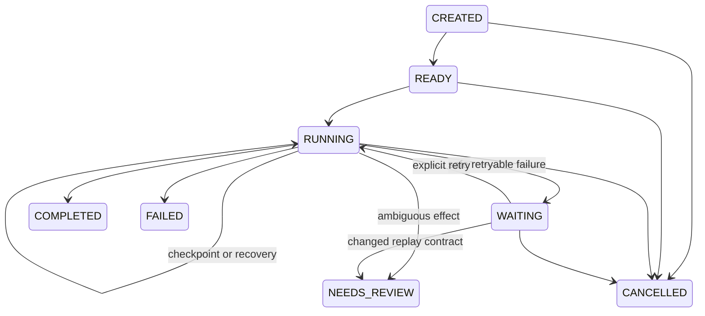

# Phase 3 — Local durable events and recoverable tasks

This offline milestone implements EVT-001, TASK-001/002, REL-001/002 and extends
ARCH-004, PER-001, IAM-007, CAP-002/003. SQLite and a sequential synchronous runner
are **provisional**, explicitly authorized for this milestone (ADR-T03). Final
storage, scheduler, authentication and policy decisions remain open. No model,
network service, real device or production authentication is used.

## Storage and operations

Python's SQLite adapter lives in `src/jarvis/storage/sqlite.py`; domain protocols
remain in `events.py`, `tasks.py`, and `observability.py`. Settings resolve
`JARVIS_DATABASE_PATH` when set, otherwise `$JARVIS_DATA_DIR/journal.sqlite3`
(default `.jarvis/journal.sqlite3`, ignored by Git). Process variables are read;
dotenv files are not loaded. Source package directories and `:memory:` are rejected.
Keep custom paths outside tracked files and on a private local filesystem.

```sh
uv sync --locked
uv run --no-sync jarvis db-init
uv run --no-sync jarvis db-inspect
uv run --no-sync jarvis db-backup --destination .jarvis/backup-2026-10-09.sqlite3
uv run --no-sync jarvis recovery-demo
```

Initialization is explicit, repeatable and runs numbered migrations under a
schema lock. `PRAGMA user_version=1` is the first storage schema; it is independent
of contract versions. Future database versions are refused without migration or
reset. Each connection enforces foreign keys, a five-second busy timeout, and
`synchronous=FULL`; initialization enables WAL. Connections are scoped to short
transactions, with `BEGIN IMMEDIATE` for writes. No database transaction spans a
provider call. SQLite owns commit ordering and crash consistency; durability
assumes a functioning local filesystem that honors fsync.

Each task checkpoint commits the current task, immutable history snapshot,
lifecycle event and lifecycle audit together. Authorization and executor outcome
audits are separately durable records, through the existing AuditSink interface.
A missing outcome after an allow/attempt means interrupted or unknown work,
not success. Storage exceptions become stable `StorageError.code` values;
`TaskManager.run` returns a structured `storage_failure`, and CLI storage errors
return JSON and a nonzero exit. Existing checkpoints remain authoritative.

`db-inspect` prints task IDs, states, revisions and completed counts, including
terminal review cases, without arguments/results. Developers can inspect
`SQLiteEventStore.read/get`, `SQLiteTaskStore.get/history/unfinished` and
`SQLiteAuditSink.records`; these are trusted local repository APIs, not public
unscoped endpoints. For metadata-only SQL inspection:

```sh
sqlite3 .jarvis/journal.sqlite3 \
  'SELECT sequence,event_type,correlation_id,occurred_at,recorded_at FROM events ORDER BY sequence;'
```

Backups use SQLite's online backup API, including committed WAL contents. The
backup destination must be a new file; existing files are never overwritten.
Do not copy only the main database file while writers are active. To reset local
development state, stop all writers, create/verify a backup with `db-backup` and
`db-inspect` pointed at the backup, then move the entire private data directory to
an archive and initialize a new directory. Do not delete WAL/SHM files from a live
database. For custom database paths, archive the database and its sidecars/lock
files together after stopping writers. Lock files must not be removed while
workers are active. There is no automatic reset command or recovery-demo cleanup
that can destroy an existing database.

New database files are created with mode 0600 and new data directories with mode
0700. Existing directory/file permissions are preserved. Events/tasks can contain
private payloads; protect the database and backups as private data. Session bearer
tokens are never included in the persisted task envelope or execution context.
Capability arguments/results must not contain credentials: providers should use
trusted runtime credentials held outside these records. Logs and lifecycle/audit
records contain only stable identifiers, states and error codes, never capability
arguments, outputs or unrestricted exception messages. Storage is neither
encrypted nor tamper-proof; append-only triggers enforce application semantics,
not protection from the filesystem owner.

## Event journal contract

The existing Event v1 is reused, with event ID/type/version, source principal,
source, UTC event time, correlation, causation and JSON payload. The adapter adds
UTC recording time and an increasing insertion sequence. Retrieval is ordered by
committed insertion sequence, regardless of event time; it supports type and
correlation filters, ID lookup, and `after_sequence`. Identical canonical content
with the same ID is an idempotent no-op; conflicting content raises
`event_id_conflict`. Updates/deletes are rejected by triggers. Invalid versions,
malformed JSON and inconsistent indexed metadata fail as `record_corrupt`.
An acknowledged append survives a new process. It does not acknowledge consumer
processing. No broker, consumer offsets or asynchronous delivery are implemented.

## Task contracts and state machine

`core/task_records.py` extends the existing Task envelope as **TaskRecord v2**.
`decode_contract` still reads all v1 primary contracts and dispatches task v2
explicitly. Task v1 remains readable but cannot be auto-converted into a runnable
plan: it lacks ordered steps, actual results, attempt history and replay metadata.
There were no persisted v1 tasks to migrate. Any future import requires an
explicit migration and trusted re-establishment of authority, never an inferred
plan. Nested TaskStep and StepAttempt records have explicit version 1; persistent
nested records missing their versions are rejected too.

| Record | Durable information |
|---|---|
| TaskRecord v2 | Existing task ID/owner/correlation/times/references, revision, eight-state status, ordered steps, authority references, cancellation flag, sanitized ErrorDetail |
| TaskStep v1 | Stable step ID, capability ID/arguments, dependencies on earlier steps, state, attempts and latest result |
| StepAttempt v1 | Unique attempt/proposal IDs, session reference, stable idempotency key, start/finish times, outcome/result, trusted replay profile fingerprint, historical policy references |



`COMPLETED`, `FAILED`, `CANCELLED`, and `NEEDS_REVIEW` are terminal: repeating run
or recovery cannot resume them. Review resolution is deliberately manual and has
no force-resume API. Invalid transitions, changed ownership/plans, removed attempt
history and changes to finished attempts/completed checkpoints are rejected.
Every save checks an expected revision and increments it; conflicting writes
cannot silently replace a checkpoint. History survives restart and records every
committed revision. Steps execute strictly in order; dependencies must name only
earlier unique steps. No parallel/DAG scheduler is implemented.

Task submission derives ownership from a fresh trusted session, accepting no
owner/authorization claims or imported execution history. Submission keys are
scoped to `(owner_id, idempotency_key)` and the original ordered plan. Repeating a
key with the same plan returns the existing task (including terminal tasks);
a different plan fails with `idempotency_key_plan_conflict`. Keys are retained
for the life of the local database. Step operation keys are
`task:<task_uuid>/step:<step_id>` and remain unchanged across new attempt UUIDs.
Provider idempotency requires atomic key/result deduplication, payload consistency
and sufficient retention; setting a registry flag alone cannot give an arbitrary
provider that behavior.

## Enforcement and recovery

For each step the runner constructs an ActionProposal with the task correlation.
**Only CapabilityExecutor invokes providers.** The executor validates arguments,
checks current trusted identity/grants and scope, durably audits the decision,
then calls a trusted `before_invoke` hook to commit `RUNNING` and a unique attempt.
If that commit fails, the provider is not called. Idempotency context is supplied
as a separate trusted execution parameter, never accepted in model proposals or
inferred from saved approvals. The trusted registry explicitly declares
`supports_idempotency`; those providers receive `idempotency_key` as a keyword.
Ordinary providers keep their original one-argument call signature. The executor
validates outputs and audits outcomes; the runner atomically checkpoints the
result before advancing.

A POSIX `flock` per task is held across execution and released automatically by
process exit. Nonblocking claims return `busy`; revision checks are an additional
transactional guard. All workers must use the same canonical database path on one
host and a local filesystem, without hard-link aliases. This is intentionally
not a distributed lease or network-filesystem worker protocol. SQL and locking
are isolated in the adapter; a PostgreSQL implementation would replace migrations,
transactions, unique/CAS operations and the claim strategy through the protocols.

Recovery enumerates unfinished tasks belonging to the supplied current principal.
It preserves completed steps and classifies an abandoned running attempt as
`OUTCOME_UNKNOWN`, retaining its history. Pure capabilities (`side_effect=none`)
and registered idempotent providers may retry with a new attempt only when both
the previous and current replay profiles allow it and the capability/scope/adapter
metadata fingerprint still matches. Unknown non-idempotent effects or changed
contracts enter `NEEDS_REVIEW` without another call. Safe timeouts and safe
outcome-audit failures enter `WAITING` for a later explicit retry; no automatic
retry loop, retry deadline or backoff is claimed. Provider/input/policy failures
otherwise terminate with stable error codes. The profile relies on trusted
provider wiring; implementations must version `adapter_ref` when their replay
semantics change.

Current authority is rechecked inside the executor for every resumed step.
Persisted principal/session/grant/decision references are history, not credentials
or grants. The Phase 2 identity and grant services remain in memory: after restart
a trusted authentication/fixture adapter must explicitly establish a fresh session
and current grants. The demo uses fixed nonsecret test principal IDs in trusted
fixture code, freshly issued tokens, and explicit owner grant/revoke calls in each
process. It never reconstructs privileges from task data. A persisted allow
cannot defeat revocation. Production identity/grant persistence remains future work.

Cancellation writes a durable cooperative request, then stops before the next
step (or at completion) after checkpointing an in-flight synchronous invocation.
It cannot undo a completed/provider-side effect or interrupt arbitrary Python
code. Cancelling an interrupted non-idempotent operation still requires review.

All required lifecycle events are persisted: `task.created`, `task.started`,
`task.step_started`, `task.step_completed`, `task.step_failed`,
`task.recovery_started`, `task.recovery_blocked`, `task.completed`, `task.failed`,
`task.cancelled`; `task.ready`/`task.waiting` also explain preparation/retries.
Task/correlation/proposal/attempt/session IDs and historical policy references link
policy, executor and recovery evidence. Codes distinguish authorization denial,
input/output validation, provider failure/timeout, persistence/audit failure,
retryable failure, unknown outcome and review. An allow audit without a completed
checkpoint is inspectable, not presumed successful.

## Actual subprocess acceptance demonstration

`uv run jarvis recovery-demo` creates a **new** private directory alongside the
configured database; it never resets or reuses the user's ordinary journal. It
runs seven separate Python worker processes and keeps both databases for inspection:

1. Three-step safe task: checkpoint the first step, then `os._exit(73)`.
2. Fresh process resumes the second step, commits a simulated provider effect,
   then `os._exit(74)` before its outcome/checkpoint.
3. Another process retries the second step with the same provider key and completes
   the third; first is called once, second twice but its effect occurs once.
4. Non-idempotent simulated effect commits then exits; another process records
   `NEEDS_REVIEW` and does not call it again.
5. Separate authorized task checkpoints its first step then exits; the recovery
   process explicitly revokes the current grant before resuming. Its second step
   is denied and the task becomes `FAILED`.

The JSON result includes paths, process IDs, states, attempt/completed counts,
provider calls, simulated effects and relevant sanitized audit outcomes. These
are real file-backed commit/crash boundaries, not only a recreated manager in one
process. Provider-call and effect counts intentionally differ. There is no claim
of exactly-once execution across arbitrary external systems, physical power-loss
tolerance, cross-host concurrency or rollback of a provider side effect.

## Validation, limits and next scope

The baseline Phase 2 suite passed 180 tests. Phase 3 adds event durability/version/
duplicate/order tests, state/history/CAS/cancellation tests, cross-process exclusion,
safe retry and ambiguous recovery tests, current-authority/forgery/revocation tests,
transaction rollback/storage/corrupt-record tests, and the seven-process CLI harness.
Exact final validation counts are recorded in FOUNDATION.md.

History snapshots include plans/results and grow with task size and attempts;
there is no compaction, encryption, retention/deletion service, per-user public
storage API, production authentication, distributed scheduler, actual deadlines,
reconciliation endpoint, or manual review resolution. Durable audit is local and
append-only by convention, not tamper-resistant. No later-phase integration is
implemented. Recommended Phase 4 is scoped local memory storage/retrieval with
provenance, consent, retention/deletion and multi-user isolation tests, using the
current policy boundary and durable journal. Model/voice/device work remains later.
