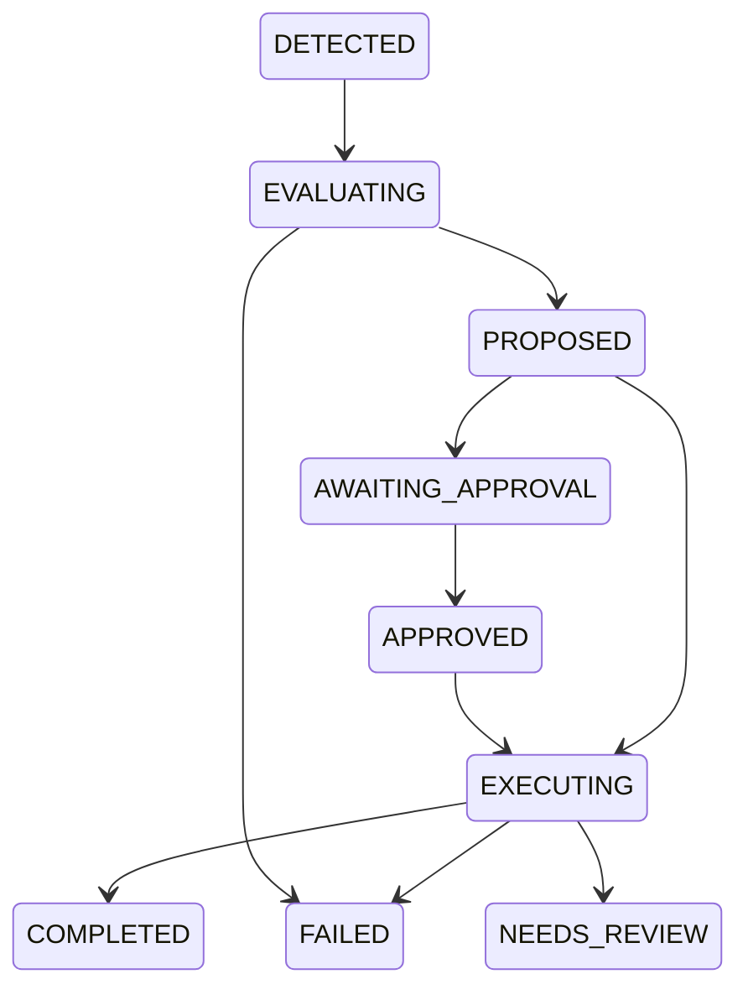

# Phase 7 — bounded, permission-governed initiative

This local milestone implements AUTO-001/002/003 without adding a privileged
execution path. It uses Phase 2 policy/execution, Phase 3 tasks/journal/claims,
Phase 4 scoped memory, Phase 5 cognition, and Phase 6 evidence/projections.
ADR-T08 is provisional. Final policy syntax, thresholds, risk taxonomy,
authentication, scheduler, storage, and retention remain OPEN.

## Modes and authority

| Mode | Result | Execution authority |
|---|---|---|
| OBSERVE_ONLY (default) | Private durable proposal/inbox entry | No execution or external notification |
| APPROVAL_REQUIRED | AWAITING_APPROVAL | Exact trusted approval plus current grants/policy/evidence |
| AUTO_EXECUTE | Bounded task | Exact enabled policy plus separately granted `initiatives.auto:<policy-id>` |

The owner configures policies through authenticated `InitiativeEngine.configure`
or the development inbox. Each policy pins one initiating principal, the same
local target principal, source, entity/location, attribute/value, exact capability
and arguments. Other principals need explicit source sharing and their own current
grants/session. The owner administers policy but cannot read or approve another
principal's private inbox by supplying its ID.

No unrestricted/global auto policy exists. Pause a policy (revision checked), or
revoke `initiatives.evaluate` / `initiatives.execute` to stop evaluation/execution
for all that principal's policies. Revoke the individual `initiatives.auto:<id>`
grant to disable automatic action independently of ordinary capability authority.
An already-started synchronous handler completes under the existing security
claim; revocation cannot roll back an in-flight effect.

Provisional exact permissions:

| Permission | Use |
|---|---|
| initiatives.manage | Configure/pause; additionally requires pinned system owner |
| initiatives.read | Read only the authenticated principal's records/history/context |
| initiatives.evaluate | Evaluate authorized durable events and recover accepted intent |
| initiatives.approve | Approve/deny/cancel only that principal's exact proposal |
| initiatives.execute | Submit/run an approved or narrowly automatic initiative |
| initiatives.auto:policy-id | Separate automatic-execution opt-in |
| world.read + world.history | Scoped world state/event consumption |
| memory.read | Optional bounded relevant memory retrieval |
| Capability-declared permissions | Existing executor's independent, current authorization |

Development bootstrap grants basic owner inbox permissions only on a **new** store.
It does not enable an auto policy or grant any `initiatives.auto:*` permission.
Reopening an existing Phase 6 store never restores/recreates grants. Use trusted
existing owner administration to grant these permissions explicitly if upgrading
an older development fixture. Production owner provisioning remains OPEN.

## Risk and rules

INFORMATIONAL, LOW, MODERATE, HIGH, CRITICAL are provisional v1 labels. Risk comes
from a trusted server catalog with exact capability/adapter identity and permitted
side-effect metadata, never from a model. Changing that catalog requires trusted
runtime code and review; arbitrary model/sensor policy expressions are rejected.

- Information-only inbox entries use INFORMATIONAL.
- `development.simulated_notice` is LOW: a fake local recommendation handler,
  with no network channel, actual messaging, or external notification.
- Existing `home.lighting.set_brightness` is MODERATE. The approval demo restores
  a simulated device setting using this established Phase 2 capability; it does
  not restart a real server or assert the environment became healthy.
- Only the exact LOW simulated catalog entry can execute automatically.
  Moderate requires approval. High/critical/unknown/real adapters are entirely
  unavailable in this milestone, including after an approval.

The deterministic generator handles registered person/occupancy/motion changes
and device availability changes. A source/event must match the policy; its
observation must still support the selected scoped projection. Old/out-of-order
reports cannot trigger a current action. Matching uncertainty is retained as a
failed/blocked proposal; a definite opposite value is irrelevant to that rule.
Task-failure, sustained-duration and repeated-fault rule families are deferred.
`ModelInitiativeGenerator` defines a future advisory boundary using the existing
ModelRequest/ModelRouter; no model initiative generator or reasoning loop runs.

## Contracts and lifecycle

Explicit v1 contracts: InitiativeTrigger, Candidate, Proposal, Decision, Policy,
Approval, ExecutionRecord, SuppressionRecord, Record, Reference and Context.
The existing recursive strict v1 decoder validates nested contracts; it rejects
unsupported/missing/bool versions and imported fields. Action semantics use
existing ActionProposal; task/execution/audit/event contracts remain authoritative.
The original Phase 1 InitiativeEvaluator protocol remains available for adapters.

Proposal intent is immutable and SHA-256 bound: trigger/origin, actor/target,
policy revision, resource and arguments, correlation/causation, evidence IDs,
original world revisions, relevant memory IDs, observed/expiry times, strength,
risk/permissions, approval requirement and suppression key. Trusted services
assign these fields. Confidence is report strength, not a calibrated probability;
person detection never establishes someone's identity.



Observe-only remains PROPOSED until cancelled/expired/invalidated. Rate/cooldown
suppression enters terminal SUPPRESSED at admission. Nonterminal states also
support cancellation/expiry/failure as listed in `TRANSITIONS`; completed, failed,
cancelled, expired, suppressed and needs-review states cannot execute again.
Every state change uses expected revision and commits history/event/audit together.
The inbox exposes the current audit reference, policy decision, proposal and task
link. Audit events contain IDs/states/codes, never memory or observation payloads.

## Approval and evidence

Approvals support PENDING, APPROVED, DENIED, EXPIRED, INVALIDATED, REVOKED and
CONSUMED. Issuance uses a currently verified principal/session/authentication
source and exact proposal hash/capability/arguments/lifetime. Approval records
retain exact current grant IDs: revoke followed by regrant invalidates the old
approval. Approval itself grants no standing permissions.

Consumption occurs durably with EXECUTING and the exact task link before any
invocation. It is single-use for that bound task; public approval replay is denied.
Recovery may use the same consumed approval only for that same task, under every
current policy/evidence/permission check and the existing replay rules.

Before approval and each invocation, checks include current policy revision and
enablement, source enablement/provenance, scoped world revision, supported truth
value, direct/inferred requirement, minimum strength, source TTL, maximum age,
proposal/approval expiry, permitted UTC hours, current memory validity/access,
action schema, catalog/risk and current capability permissions. Any changed or
inaccessible dependency blocks execution. Recovery also reevaluates pending and
observe-only proposals. Time expiry is lazy on evaluation/recovery, not a daemon.

## Durable consumption, suppression and recovery

Migration **6** preserves migrations 1–5 without provisioning new authority.
It adds policies/cursors, initiative records, immutable history, event receipts,
and suppression records. Approval/execution records are nested in the same
revision-protected initiative row; their updates share the lifecycle transaction.
Back up existing databases before explicit initialization/migration.

`WorldModel.events(after_sequence=..., limit=...)` extends the existing scoped
journal API with ascending bounded pages of `(sequence, Event)` pairs. Default
history behavior is preserved. Authorization/scope validation precede pagination;
raw global journal/audit stores remain trusted operator internals.

A visible event's receipt, admitted proposal or suppression, and per-policy cursor
commit in one SQLite transaction. A storage/audit failure leaves the cursor
unchanged; retry rereads that event. Interruption after acceptance leaves DETECTED
intent that `recover` evaluates without another delivery. Irrelevant events get
receipts too. No recent-100 window can silently skip an older accepted event.

Each pass handles at most 100 visible events per policy, with at most 20 policies
per principal. Default pass size is 20. The host schedules finite calls to
`process`/`recover`; this milestone adds no permanent daemon or distributed worker.

Suppression keys bind policy/principal/source/resource/value/exact action, excluding
per-observation UUID/revision. Thus repeated fresh reports cannot cause a burst of
actions. Cooldowns (default 60s), all-policy principal rate windows (default 10/h),
and active-count limits (default 10) use persisted state and transactional admission.
Failed admitted proposals also consume rate/cooldown budget; SUPPRESSED records do
not. At the actual first invocation, the guard independently checks current principal
execution-rate and per-key cooldown windows and commits `admitted_at` with the
initiative's CAS/event/audit transaction before the task attempt/handler. Delayed
approvals and deferred automatic proposals cannot accumulate outside an admission
window and then bypass execution limits. Crash reservations conservatively consume
budget; the same bound task's safe recovery reuses its slot after current authority/
evidence checks. A rate denial cancels its task, persists FAILED and invokes nothing. A new supported observation after cooldown may create a new opportunity.
Duplicates already consumed have durable receipts even after cooldown/restart.
Suppression/history are retained; physical purge/retention periods remain OPEN.

Task submission has stable `initiative:<UUID>` key and persistent guard reference.
If death occurs before linking, submission finds the same task. The task's guard
reference is immutable and participates in idempotency compatibility. Every task
invocation, including direct `TaskManager.run/recover`, checks the registered
initiative guard inside the executor's trusted pre-invocation hook. Missing resolver,
changed intent, missing approval, revocation or stale evidence blocks the handler.
Task guards cannot be supplied by model output.

Local POSIX initiative claims prevent two workers invoking one initiative; existing
security/task claims remain authoritative. Claims release on real process death,
not a TTL. Known completed steps finalize without another effect, even after
revocation. An interrupted non-idempotent attempt becomes NEEDS_REVIEW through
Phase 3 recovery. Arbitrary external exactly-once semantics are not claimed.
Manual resolution of NEEDS_REVIEW and anti-rollback/tamper-resistant storage are
still deferred. Never delete live lock/WAL/SHM files to bypass a claim.

## Inbox and conversation

```bash
uv run jarvis initiative-demo
uv run jarvis initiatives list --database <printed-demo-database>
uv run jarvis initiatives show <initiative-id> --database <database>
uv run jarvis initiatives approve <initiative-id> --database <database>
uv run jarvis initiatives deny <initiative-id> --database <database>
uv run jarvis initiatives cancel <initiative-id> --database <database>
uv run jarvis initiatives process --database <database>
uv run jarvis initiatives recover --database <database>
uv run jarvis initiatives policies --database <database>
uv run jarvis initiatives configure --policy-file policy.json --database <database>
uv run jarvis initiatives pause <policy-id> --expected-revision 0 --database <database>
uv run jarvis chat --database <database> --model-provider fake
```

The CLI defaults to a separate `.jarvis/initiatives/journal.sqlite3` fixture store.
`--identity owner/friend/guest` is explicitly development-only trusted host selection;
a UUID never authenticates a caller. `approve` immediately attempts the exact
approved action through TaskManager; APIs also support approving without running.
`configure` requires a serialized complete InitiativePolicy v1; updating uses
`--expected-revision <old-revision>` and the next revision in the file. Sources
must already be registered through the trusted Phase 6 service. No command imports
an approval or grants an automatic-execution permission.

ContextBuilder supplies at most three scoped initiative summaries inside its
existing byte budget. Keyword resource/state filters apply before LIMIT; an older
pending garage proposal is not lost behind newer unrelated entries. Replies render
stored lifecycle/approval/task/result and original evidence alongside current
world status. A completed simulated call does not establish issue resolution.
There is no fabricated reasoning trace or inference of recognized people.

Example fake chat: `What actions are awaiting my approval?` produces
`AWAITING_APPROVAL; approval=PENDING; verified task=none, result=none` with IDs and
original/current evidence. `The owner approved it` cannot approve an initiative;
use the trusted inbox. Initiative inspection/approval phrases are handled as
inspection, with no conversational execution or permission mutation.

Current initiative/world references are rechecked before model-output use, history
reuse and completed-reply replay. Changed/revoked context is excluded or returns
`context_authorization_changed`. Conversation restart uses the existing private
persistent session/conversation boundary.

Cloud remains disabled. Even a separately configured future cloud adapter requires
current `model.egress:<provider>:initiatives` and world grants, including history,
as well as conversation/identity/capability classes and destination enablement.
Unauthorized summaries never reach a model/adapter. Local endpoint configuration
remains in PHASE5.md: loopback OpenAI-compatible Ollama, LM Studio or llama.cpp;
real-model inference is optional for Phase 7 and separately unverified here.

## Validation and demonstration

Baseline: **563 passing tests** before implementation. Final full suite:
**642 passed**, **79 added**, on Python 3.12.14. Frozen installation,
Ruff lint/format, whitespace checks, source distribution and wheel build passed.
All seven demos, inbox show/list/approve, persisted fake chat, repeated schema 6
initialization, inspection, online backup and backup inspection passed from the
checkout and a separately installed wheel outside it. The latter imported actual
site-packages and independently resolved its runtime dependencies. CI runs the
same workflow on Python 3.12/3.13; hosted results are attached to the PR. The new tests exercise actual handler counts, denial,
revocation/regrant, current dependencies, corruption, rollback, bounded paging,
separate-process crash windows, exclusive workers and cloud-adapter non-invocation.
Existing Phase 6 trust/replay/out-of-order/conflict/disconnection tests remain.

The demo uses three actual processes: initial scenarios, death after a real simulated
invocation but before checkpoint, then restart. It prints concise JSON references
rather than enormous audit arrays. Observed scenarios:

| Scenario | Verified behavior |
|---|---|
| A | Porch person evidence, observe-only PROPOSED, zero handlers |
| B | Device offline; approval pending, trusted exact approval, simulated setting restoration COMPLETED |
| C | Narrow LOW simulated local recommendation auto grant, COMPLETED |
| D | Five repeat opportunities SUPPRESSED, recommendation handler still called once |
| E | Revocation invalidates approval; FAILED, no extra handler |
| F | Expired source evidence changes revision; FAILED, no extra handler |
| G | Pending approval persists, completed tasks unchanged, suppression persists, revoked grant remains absent, interrupted effect NEEDS_REVIEW |

The first process invokes lighting once and notice once. A separate controlled
process invokes one simulated ambiguous notice before death. Restart adds **zero**
lighting/notice calls and preserves its one effect marker; no blind retry occurs.
Stored correlation/causation, evidence and final audit references are printed.

Actual demonstration excerpt (IDs/evidence/audit references remain in full output):

```json
{
  "status": "ok",
  "A_observe_only": "PROPOSED",
  "B_approved": "COMPLETED",
  "C_automatic": "COMPLETED",
  "D_suppressed": 5,
  "E_revoked": "FAILED",
  "F_stale": "FAILED",
  "G_pending": "AWAITING_APPROVAL",
  "G_ambiguous": "NEEDS_REVIEW",
  "handler_calls_after_restart": {
    "lighting": 0,
    "notice": 0
  }
}
```

## Files and requirements

Created: `core/initiative_records.py`, `storage/initiatives.py`,
`initiative_development.py`, `initiative_demo.py`, `initiative_cli.py`,
`tests/test_initiatives.py`, `tests/helpers/initiative_worker.py`, this document.

Extended: `initiative.py`, `core/contracts.py`, `core/task_records.py`,
`core/cognitive_records.py`, `task_manager.py`, `storage/sqlite.py`,
`storage/world.py`, `world_state.py`, `context.py`, `cognition.py`, `models.py`,
`egress.py`, `cognitive_runtime.py`, `__main__.py`, CI, README, ROADMAP,
REQUIREMENTS, ARCHITECTURE, DECISIONS, PERMISSIONS, FOUNDATION and PHASE3.
No dependency or lockfile changes, parallel execution stack, real device,
external messaging, biometric recognition, profiling, autonomous purchase,
continuous agent loop, distributed worker or production cloud provider is added.

| Existing IDs | Implemented scope |
|---|---|
| AUTO-001/002/003 | Scoped finite proactive evaluation, opt-in policy modes, disable/pause/revocation, observable bounded lifecycle |
| ARCH-001/002/003/004, DEV-003 | Local/offline rules/fakes, replaceable interfaces, explicit contracts and decode |
| IAM-001/002/003/004/007, PER-001/002/003 | Trusted current authority, isolated inbox, owner admin, exact grants/approvals and audits |
| CAP-001/002/003, TASK-001/002 | Registry/schema/executor integration, guarded durable tasks and verified outcomes |
| EVT-001, REL-001/002 | Atomic receipts/checkpoints, recoverable accepted intent and structured failures |
| MEM-003/004/005/006 | Existing scoped current memory dependencies, revocation/tombstones/supersession |
| WORLD-001/002/003 | Current evidence/inference/strength/TTL/conflict/revision/source checks |
| COG-001, SEC-001/002/003/004 | Bounded isolated explanations/history, default-deny separate initiative/world egress |

No invented requirement ID is needed. AUTO-002's eventual continuous product
behavior remains phased; this implements finite scheduled passes. COG-002 and
WORLD-004 remain PROPOSED. IAM-005, PER-004, TASK-003/004 and WORLD-005 remain OPEN.

Phase 8 should add a local notification abstraction and recipient/channel policy
with simulated delivery, durable delivery keys and recovery, before real external
channels. Owner review is still needed for production authentication, exact risk/
thresholds, approval lifetime/stronger authentication, retention, real device/
channel grants and scheduler deployment. None was silently ratified here.
