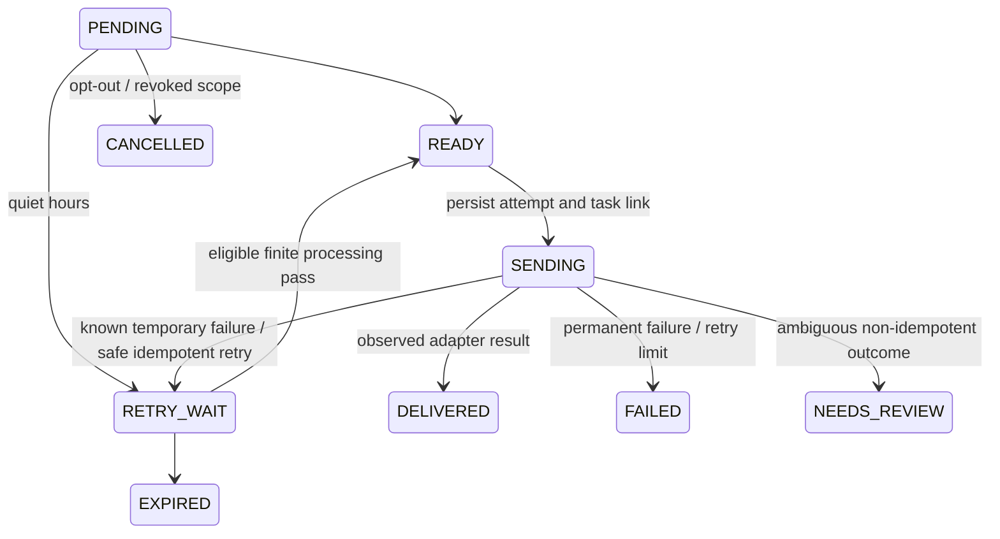

# Phase 8 — durable local notifications and interaction delivery

The baseline passed **642 tests in 91.11 seconds** on Python 3.12.14 before
implementation. This milestone extends the actual Phase 2–7 authority, executor,
tasks, journal, memory, world, initiative and conversation services. All channels
are local or simulated; no external message or private network transmission occurs.
Accepted ADR-001–012 remain binding. ADR-T09 is provisional; ADR-P04 remains
PROPOSED and the final notification providers, severity policy and production
authentication remain OPEN.

## Requirements and contracts

The actual repository has one notification requirement: **COM-001**, required
product behavior and capability dependent. This milestone implements its local
urgency/channel-policy slice; eventual real phone/text acceptance is deferred.
No additional requirement IDs were invented. It also extends ARCH-001/003/004,
IAM-001/003/004/007, PER-001/002/003, CAP-002/003, TASK-001/002, EVT-001,
COG-001, SEC-001/002/003/004, REL-001/002 and DEV-001/003. MEM-003/004/006,
WORLD-001/002/003 and AUTO-001/003 remain authoritative dependencies.

Strict explicit v1 contracts in `core/notification_records.py` cover Notification,
Content, Recipient, Policy, Channel, Delivery, Attempt, Interaction, Preference,
Reference, Source, DeliveryRequest/Result and bounded Context. Unknown fields,
unsupported/missing/bool outer or nested versions, invalid recipient IDs and
priority values are rejected. Existing task/identity/initiative/audit/event
contracts are reused. Nested JSON is revalidated and copied at boundaries.

A Notification pins trusted origin/subsystem, one explicit recipient, immutable
source/revision, policy/revision, correlation/causation, category, priority,
private/shared classification, bounded content/evidence and optional initiative
approval reference, creation/expiry, retained deduplication key, inbox state,
transport summary, revision and current audit ID. Retention is explicitly
`retention.manual`; no physical purge or period is silently chosen.

Provisional priorities are LOW/NORMAL/HIGH/URGENT. Categories are informational,
task status, initiative proposal, approval request, system warning, device status
and security. Current source adapters produce task, initiative, authorized memory
and world updates; arbitrary model-authored system/security messages are not a
trusted source. Priority comes only from an owner-configured policy.

## Trusted routing and privacy

`NotificationService.configure` requires the pinned system owner plus current
`notifications.manage`. Policy pins origin, recipient and source kind/optional
exact resource. Those bindings cannot change in place. Each origin has at most
20 policies. Known active principals and registered local/simulated channels are
required. A detected subject/person is never a recipient-selection authority.

`create(policy_id, NotificationSource, session_token=...)` accepts a reference,
not arbitrary content, recipient, priority, delivery status or approval. It reads
the actual source through its existing service, verifies the reference and derives
content deterministically. Caller-supplied event/causation claims are rejected;
the trusted source ID is the causation reference. Source task/initiative IDs and
correlation IDs retain their actual execution provenance. Task arguments and
outputs are not copied into notifications. Memory/world/initiative content remains
data, never authorization or an instruction. Oversized content and recognized
secret patterns fail rather than being truncated into a different claim.

Recipients need current `notifications.read` and the actual source scope/grants.
Tasks and initiatives route only to their exact owner. Memory/world may route to
an explicitly shared recipient, using trusted principal/grant/scope checks; no
recipient session is forged. Household memory also requires its existing separate
grant. Each recipient has an individual notification/delivery/interaction record.
The system owner cannot read someone else's private inbox by supplying its ID.

Every retrieval and send reads current authority again, including source memory
validity/tombstone/supersession, world scope and initiative evidence access. Source
permission revocation hides stored copies on subsequent reads and prevents sends.
SQL filters recipient ownership before decoding, search, order and pagination;
there are no global counts or recipient-discovery endpoints. Missing, foreign and
inaccessible notification IDs use `notification_unavailable`. Delivery claim
contention uses the same public unavailable code, revealing no private busy state.
Local database/Python internals remain trusted infrastructure, not a plugin sandbox.

Provisional permissions:

| Permission | Boundary |
|---|---|
| notifications.manage | Owner-only trusted routing configuration |
| notifications.publish | Authenticated pinned origin; source access still required |
| notifications.read | Exact recipient inbox and current source authority |
| notifications.interact | Recipient read/unread/acknowledge/dismiss/expire with expected revision |
| notifications.preferences | Own preferences only, revision checked |
| notifications.deliver | Own bounded delivery processing; current origin publishing, source, policy and preferences also checked |
| Existing initiative approval/execute grants | Separate trusted Phase 7 approval workflow; notifications confer none |

Development bootstrap grants basic notification rights only on a NEW fixture
store and owner-only manage. It creates no routing policy. Reopening/migration
never seeds new grants or restores revoked ones. Other configured principals work
through the same APIs; CLI identity labels are development-host fixtures only.

## Inbox and transport lifecycles

The local inbox is authoritative: notification intent and the local-inbox
DELIVERED record commit together before any simulated send. Inbox states are
UNREAD, READ, ACKNOWLEDGED, DISMISSED and EXPIRED. Read/unread are allowed only
between the first two. Acknowledgement and dismissal are separate transitions;
a dismissed item cannot later be acknowledged. Expiry blocks sends/approval
immediately and can be persisted with the explicit `expire` interaction.
Context also labels expired items without claiming the retained bytes were erased.

Each additional channel has a separate lifecycle:



Attempts retain number/UUID, provider, stable per-recipient/channel key, task,
start/finish/admission times, classified error, retryability, outcome evidence and
provider reference. Delivered means committed local inbox or simulated provider
report. It never means received by a human, read, acknowledged or approved.
Completed attempts and immutable source/key/channel/task bindings cannot be
rewritten by an ordinary update. CAS changes commit state, attempt rows, journal
event and content-free audit together and increment the notification revision.

`DeliveryChannel.send(NotificationDeliveryRequest) -> NotificationDeliveryResult`
is the replaceable adapter port. LocalInboxChannel represents actual admission
commit; SimulatedPushChannel supplies synthetic success and a durable SQLite
key/payload/result ledger; SimulatedUnreliableChannel additionally exercises known
temporary/permanent failure, timeout, unknown outcome and duplicate responses.
Registration pins stable IDs, principal address type, privacy/destination and
idempotency semantics. Cloud registrations are refused in Phase 8.

## Tasks, safe retries and bounded work

Delivery uses existing `TaskManager.submit/run` and `CapabilityExecutor` only.
Each logical attempt has stable `notification:<delivery-id>:<number>` submission
key and a persistent `notification:<delivery-id>` execution guard. The registry
marks transport capabilities as requiring that guard family. Direct executor calls
and model-created tasks without a guard are denied; these internal capabilities
are excluded from conversational discovery. Existing ordinary capability replay
fingerprints remain unchanged when no required family is registered.

The guard verifies exact task/recipient/intent/correlation, SENDING attempt link,
current source access, recipient/origin grants, active principal, policy revision,
channel metadata, category/priority preferences, quiet hours and delivery budgets.
It runs in the established executor checkpoint before the task attempt/handler.
Missing resolvers deny, including general TaskManager recovery. Submission/link
crashes find the same task; a task not yet linked to SENDING cannot invoke.

Known completed checkpoints finalize without another send. Unknown non-idempotent
effects become terminal NEEDS_REVIEW, including process death after an actual fake
effect. Idempotent recovery uses the documented fake ledger and unchanged key/
immutable payload, while current authorization still applies. Task attempts retain
every recovery invocation; a notification attempt references that task. Default
maximum logical attempts is 3 (configurable 1–10), default retry delay 60 seconds.
No arbitrary external exactly-once delivery is claimed. There is no force-resume
or manual review-resolution API in this milestone.

POSIX nonblocking per-delivery claims precede security waiting; process death
releases them without proving no effect occurred. Existing task claims and
host-wide security locking serialize invocation/revocation. A started synchronous
adapter finishes before a waiting revocation commits. These are one-host/canonical
local-filesystem guarantees, not distributed leases. Never remove live claim files.

Admission applies retained per-recipient/policy/source/state deduplication keys,
source cooldown (default 60s, plus recipient preference), bounded active-delivery
queue (default 100), and persistent suppression records. Repeated task/initiative
states remain deduplicated for the retained database lifetime; world/memory
revisions may represent new updates, bounded by cooldown. No model raises priority
to evade these controls. At first actual invocation, durable admitted reservations
enforce recipient and channel rates (default 30/hour). Delayed work cannot bypass
these limits; own safe task recovery reuses its slot. Budget deferrals retain intent.
Priority orders bounded processing; it never grants action privileges.

## Quiet hours, bridge and approval

Preferences are explicit per-principal categories/channels, IANA timezone,
minimum priority, optional cooldown and paired local-minute quiet endpoints.
Midnight-spanning schedules are supported. Scheduling evaluates actual UTC
instants in the recipient timezone; DST gaps are not manufactured and both folds
are evaluated. A bounded two-day minute search finds the next eligible instant.
The inbox retains deferred content. URGENT override requires both trusted URGENT
policy priority and an explicit owner-configured override; opt-outs remain effective.
Clocks are injectable. No preference inference or background daemon is installed.

`bridge` consumes bounded ascending origin-owned task/initiative history pages,
not the global event journal. Intermediate states get receipts without messages;
task notifications exclude guarded internal tasks to prevent recursive storms.
For eligible lifecycle records it resolves current source state, so replay cannot
revive an old approval request. Receipt/cursor/admitted notification or suppression
commit atomically. An audit/storage failure rolls back that admission and cursor.
A crash after commit is recovered from the existing inbox. Each finite pass handles
at most 100 entries per policy (default 20). Hosts explicitly call bridge/process;
no second general-purpose scheduler is introduced. Memory/world reference creation
is available; automatic world event routing is deferred.

Approval-request content holds the initiative UUID and evidence references, not
an approval token. Reading/acknowledging does nothing to the initiative. Trusted
`approval(... expected_revision=..., deny=False)` invokes the EXISTING Phase 7
approve/execute services; current grants, exact approval bindings and evidence
are revalidated there. Denial uses that same service. Old notification inspection
reports the current initiative state; successful simulated action does not assert
an environmental issue was resolved. Expired/dismissed/cross-user requests cannot
approve. Changed/consumed/revoked initiative intent cannot be replayed through a link.

## Cognition and local CLI

Notification inspection adds at most three authorized summaries to the existing
byte budget. Literal resource/new-unread filters apply before bounded selection;
old garage notifications remain findable behind newer unrelated items. Summaries
distinguish inbox, transport and CURRENT source state. The coordinator renders
these observed states deterministically and never executes a model's claimed
notification acknowledgement or approval. Conversation dependencies include both
notification and current source revisions, revalidated before model output, reply
replay and history reuse. Revoked/changed data cannot re-enter via old replies.

Cloud models remain default off, with no automatic fallback. Any future call
containing notifications OR notification-derived history needs a separate current
`model.egress:<provider>:notifications` grant. Until final classification rules,
it also conservatively requires memory/world/initiative egress plus the existing
conversation/identity/capability grants. Channel choice is not cloud authorization.

```sh
uv sync --locked
uv run jarvis notification-demo
uv run jarvis notifications list --database <printed-database>
uv run jarvis notifications show <id> --database <database> --json
uv run jarvis notifications read <id> --expected-revision <revision> --database <database>
uv run jarvis notifications acknowledge <id> --expected-revision <revision> --database <database>
uv run jarvis notifications dismiss <id> --expected-revision <revision> --database <database>
uv run jarvis notifications approve <id> --expected-revision <revision> --database <database>
uv run jarvis notifications bridge --database <database>
uv run jarvis notifications process --database <database>
uv run jarvis notifications recover --database <database>
uv run jarvis notifications preferences --database <database> --json
uv run jarvis notifications configure --policy-file policy.json --database <database>
uv run jarvis notifications set-preferences --policy-file preferences.json --database <database>
uv run jarvis chat --model-provider fake --database <database>
```

`unread`, `expire`, `deny` and `policies` are also supported. List offers
`--after <recipient-cursor>` and literal `--text`; `--json` gives strict structured
output. Default output is concise, with no enormous audit arrays. Mutation commands
require the displayed expected revision. Default store is the separate ignored
`.jarvis/notifications/journal.sqlite3`. `--identity owner/friend/guest` is trusted
development-host selection, never public authentication. Existing ordinary kernel
database overrides are not silently used as development inbox authority.

## Offline demonstration and migration

The executable demo uses three actual processes, real SQLite/services/executor,
synthetic clocks, and fsynced fake-effect marker. Example measured summary (IDs vary):

```text
status=ok, mode=offline_simulated, processes=3
first: guest_denial=notification_unavailable, approval_handler_calls=1
quiet_delivery=RETRY_WAIT, transient_delivery=RETRY_WAIT, duplicates_suppressed=20
reopen: owner_notifications=5, basic_inbox=ACKNOWLEDGED
basic/approval/quiet/transient=DELIVERED, ambiguous=NEEDS_REVIEW
friend_revocation=CANCELLED, ambiguous_effects=1
restart push_calls=2, unreliable_calls=1; completed basic was not repeated
```

The full JSON retains concise notification/source/audit IDs. Acknowledgement
does not execute; explicit Phase 7 approval invokes exactly one simulated handler.
The crash occurs after the non-idempotent fake effect, before its result checkpoint.
Recovered ambiguous work invokes nothing. Read/ack state, preferences, dedup and
revocations persist. All generated stores are new ignored UUID directories;
existing user work/databases are preserved.

Migration **7** preserves migrations 1–6 and adds notifications, recipient deliveries,
attempts, interactions, preferences, policies/cursors/receipts, suppression/rate
indexes and the simulated adapter ledger. No authority is reconstructed or regranted.
Initialization is repeatable; use the existing online backup to a NEW destination
before migration. Protect DB/WAL/backups/claim directory as private local data.
Append-only records/CAS are application protections, not filesystem-owner tamper
resistance, anti-rollback, encryption or physical erasure.

## Files and validation

Created: `core/notification_records.py`, `notifications.py`,
`storage/notifications.py`, `notification_channels.py`, `notification_cli.py`,
`notification_demo.py`, `tests/test_notifications.py`,
`tests/helpers/notification_worker.py`, and this report.

Extended: `capabilities.py`, `execution.py`, `task_manager.py`, `core/contracts.py`,
`core/cognitive_records.py`, `context.py`, `cognition.py`, `models.py`, `egress.py`,
`cognitive_runtime.py`, `__main__.py`, CI, README/ROADMAP/REQUIREMENTS/ARCHITECTURE/
PERMISSIONS/DECISIONS, FOUNDATION and PHASE3 migration operations.

Tests assert actual adapter/executor calls, privacy/current source revocation,
strict contracts, source immutability, secret/injection rejection, separate inbox
interactions, exact Phase 7 approval/expiry, bounded replay/cooldown/queues/rates,
quiet hours/timezones/DST, preference changes, provider failures and cloud rejection,
current source/history dependencies, transactional rollback and migration.
Independent workers cover active-claim races and death before effect, after effect
and after known result, including durable idempotent ledger recovery and conservative
non-idempotent review. The demo/CLI exercise installed entry points.

Final local validation on Python **3.12.14**: **723 passed in 149.30s**,
including **81 new Phase 8 cases** and the original 642 regressions. Frozen uv
installation, Ruff lint, Ruff format (**102 files**), whitespace checks, source
distribution and wheel build passed. All eight demos, notification list/show/
preferences/recover, guest denial, persisted fake chat, repeated schema 7
initialization/inspection and online backup passed in both the checkout and an
independently installed wheel outside it; installed runtime source matched the
checkout. The CLI display follow-up passed its actual demo/CLI subprocess test.
Hosted Python 3.12/3.13 results are linked from the PR when complete.

## Limits, owner decisions and Phase 9

Production authentication/provisioning, final contracts/policy syntax, priority/
category mapping and urgent exceptions, channels/providers/addresses, receipt
semantics, physical retention, manual ambiguous-outcome reconciliation, distributed
claims and permanent scheduling remain OPEN. No real email/SMS/push, calls, network
notification services, public HTTP, physical devices or unbounded agents are added.
Genuine local inference remains a separate Phase 5 acceptance gap in this environment;
Phase 8 fake/protocol tests do not establish it.

Recommended Phase 9: select and implement one explicitly authorized real sensor
adapter behind the existing source/world services, first resolving enrollment,
collection/consent/retention, evidence confidence and health policy. Keep real
notification providers separate until authentication, egress/address policy,
provider reconciliation/idempotency and owner-approved severity rules are settled.
No owner decision is needed to review this reversible offline milestone.
