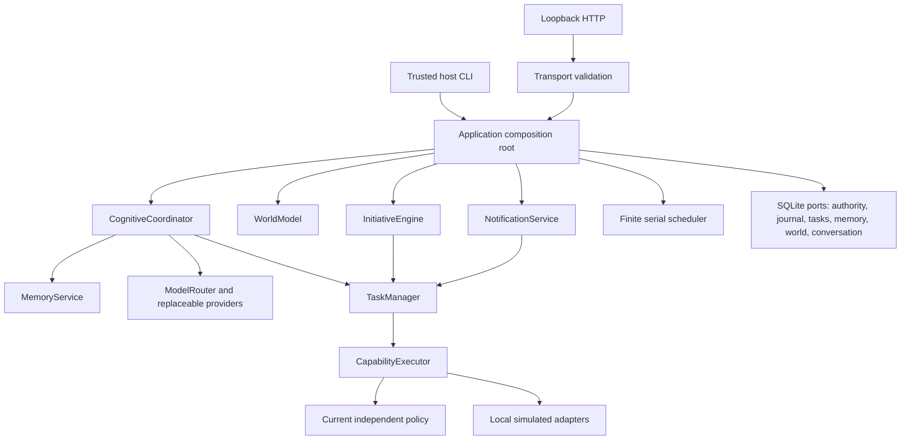
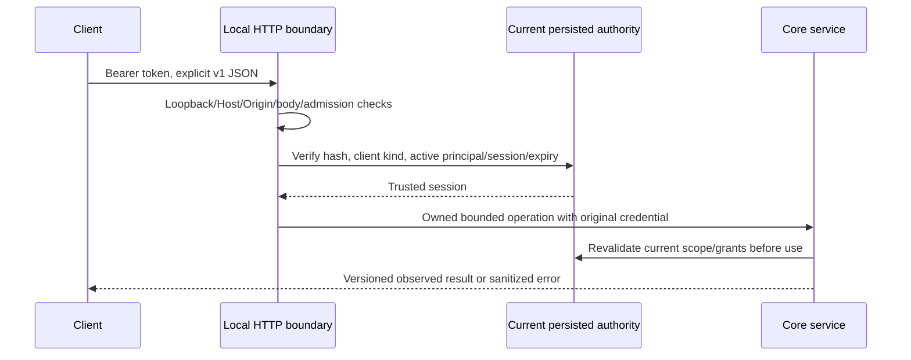
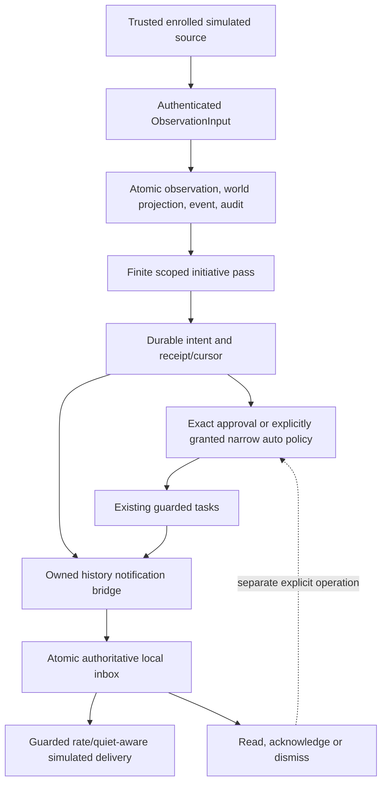
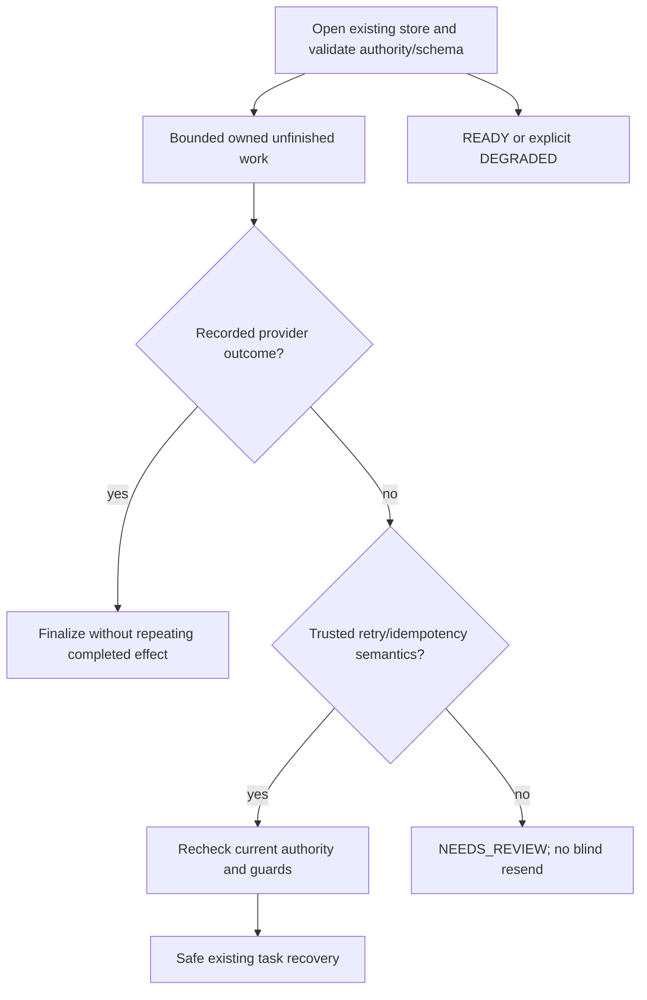
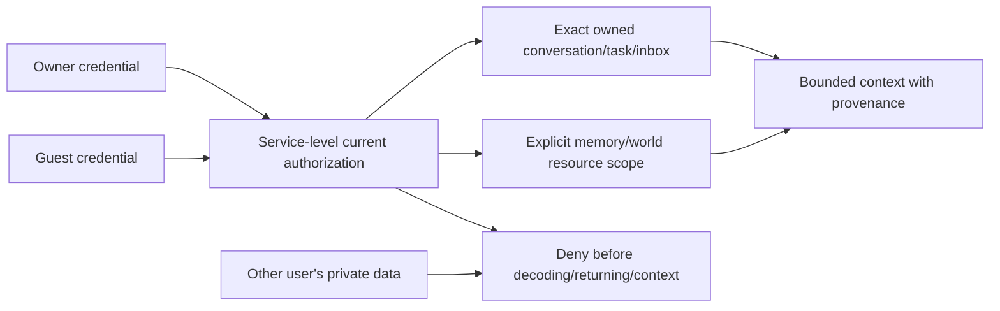
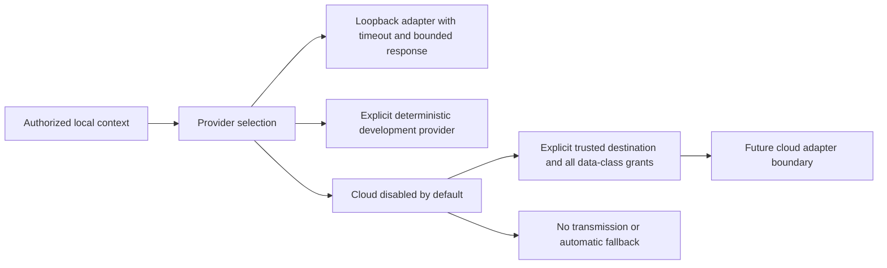

# Integrated architecture and trust boundaries

The v0.9 runtime composes existing Phase 2–8 services; it does not introduce a
second executor, authorization engine, memory store or recovery system.
`application.build_application` is the shared composition root. Legacy
`cognitive_runtime.development_runtime` delegates to it; runtime/API tests and
the server use it with a credential-bound development identity repository.
Domain services depend on protocols and typed contracts, not FastAPI.

## Components

The same identities, policy, registry, task guards, audit writer and database
instances are shared. A runtime claim permits one server per database on a
single POSIX host; task/domain claims protect individual operations. SQL
transactions remain short. Provider invocation occurs outside SQL transactions
but under the established current-authority boundary. Never hold an outer
identity lock before acquiring a domain claim; domain services own lock order.

## Authenticated request

No HTTP endpoint creates authority or accepts a role, principal or owner session
claim. Host provisioning is an explicit development operation. It stores only
credential hashes in SQLite and writes tokens to new private files. UUIDs are
resource references, never authentication. Browser-origin requests are denied.

## Cognition and action

```mermaid
flowchart LR
  Request[Authenticated request] --> Context[Bounded authorized current context]
  Context --> Provider[Fake or loopback local model]
  Provider --> Decision[Strict CognitiveDecision validation]
  Decision --> Reply[Direct or verified grounded reply]
  Decision --> Proposal[Untrusted ActionProposal]
  Proposal --> Task[Durable TaskManager submission]
  Task --> Guard[Current policy and immutable task guards]
  Guard --> Handler[Validated capability provider]
  Handler --> Result[Validated ExecutionResult and audit]
  Result --> Reply
```

One bounded decision/action is allowed per request. Model text never invokes a
handler or changes permissions. A proposal is not proof of successful execution;
responses use actual task/result states. Current source references are rechecked
before persisted replies/history enter another model context.

## Observation to notification

Acknowledgement never approves an initiative. Original evidence/intent remains
distinct from current state. Quiet hours and current source/recipient authority
apply to delivery and recovery. Ordinary task recovery skips domain-bound tasks;
initiative/notification recovery owns their prerequisite checks/finalization.

## Recovery

SIGINT/SIGTERM immediately stops admission and signals the scheduler. Active
request/scheduler threads remain tracked despite caller cancellation. Drain uses
one deadline; timeout/second interruption exits the process with status 2 and
preserves ambiguous RUNNING attempts. No external exactly-once guarantee exists.

## Privacy

Owner administration does not confer a bypass to another user's private data.
Foreign/missing resources have the same unavailable response. Public health has
booleans/lifecycle only; detailed operational metrics require the pinned owner.
Audit and raw storage are trusted operator internals, not public data endpoints.

## Model egress

Local endpoint validation and no-proxy/no-redirect HTTP prevent ordinary model
selection becoming remote transmission authorization. Memory/world/initiative/
notification-derived history retains its data-class requirements. Retrieved
content is data, never system instructions or authority.

Migration 8 adds revocable credential bindings and preserves all prior security
and domain state. SQLite, POSIX claims, one serial scheduler, local development
authentication and HTTP v1 remain **provisional** (ADR-T10). Production auth,
distributed claims, exact public API, calibrated risk, retention/reconciliation
and a homelab deployment remain OPEN. See [decisions](../../DECISIONS.md).

For a future homelab deployment, keep the core authoritative on a private host,
replace development credential provisioning with a selected trusted authenticator,
enroll narrow adapters and decide collection/retention first. Move storage through
its ports with versioned migration/backup, not by changing model ownership or
bypassing policy. Distributed claims, remote inference, TLS/remote client access
and real notification destinations require explicit decisions and acceptance;
loopback bind restrictions are intentional in this release.
